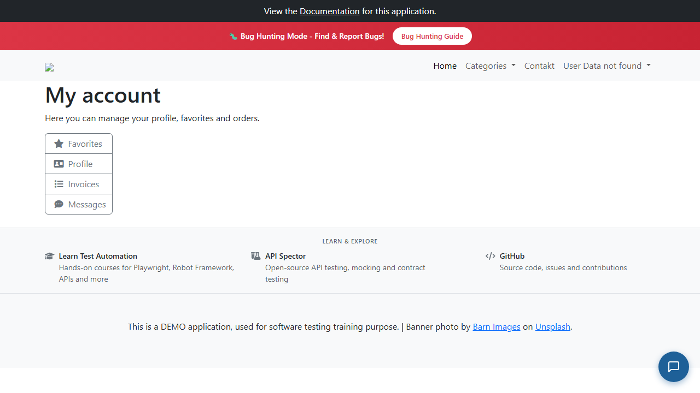
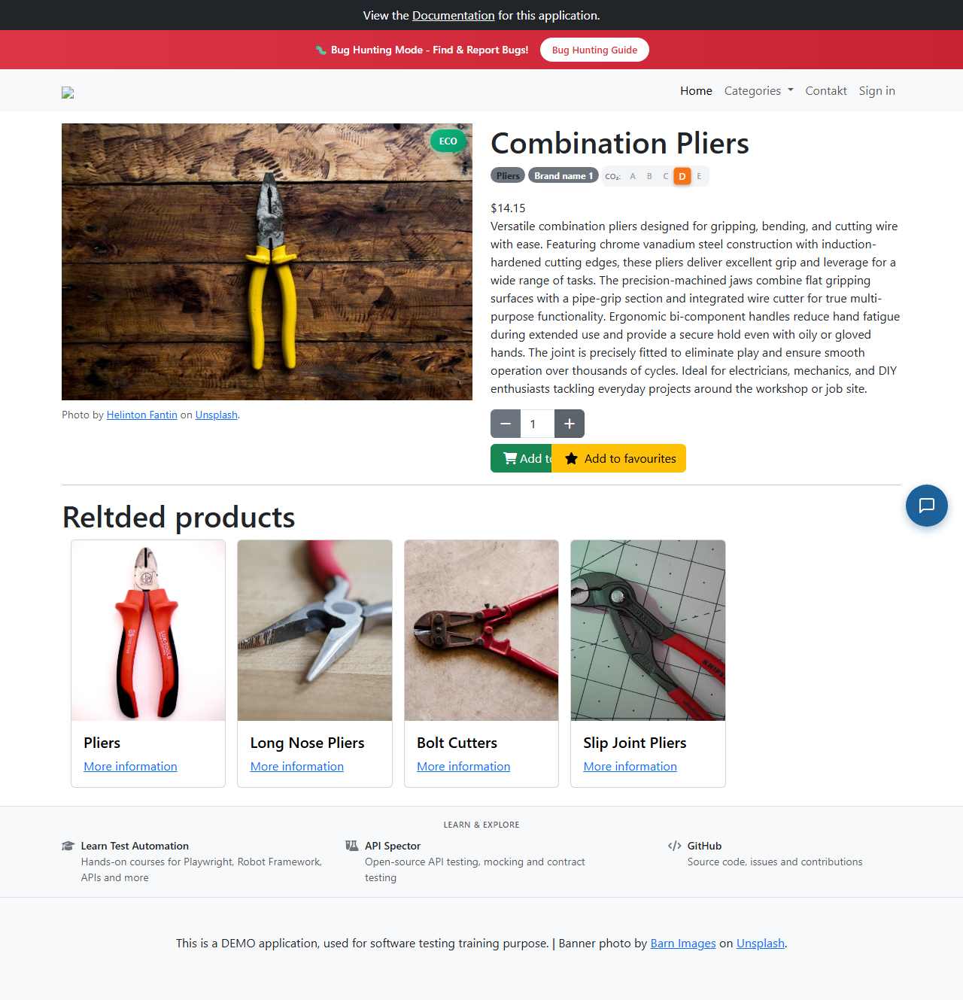
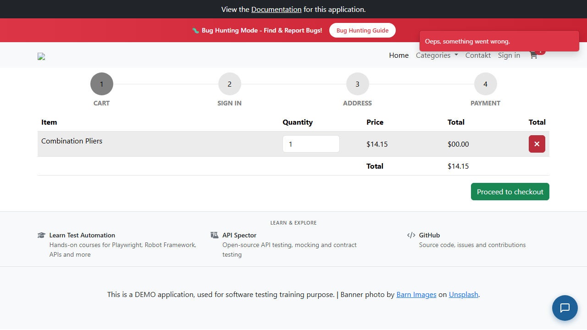
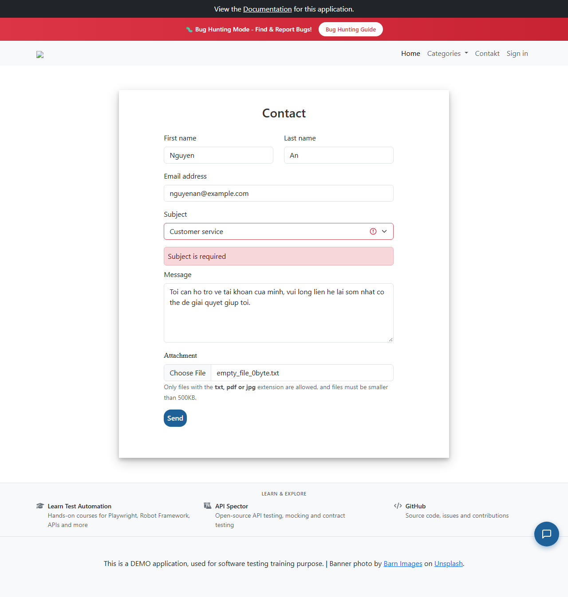
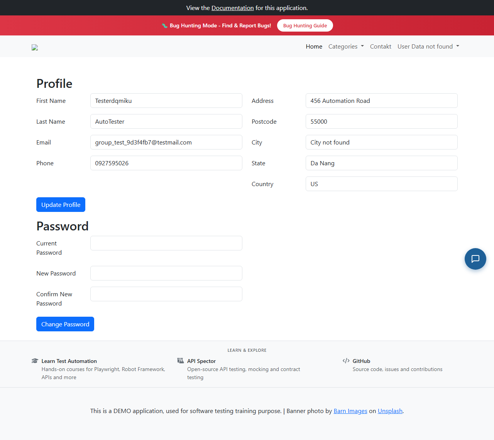

# BÁO CÁO LỖI HỆ THỐNG BUGGY (BUG_REPORT.md)

Tài liệu ghi nhận kết quả kiểm thử hồi quy đối soát (Regression Testing) trên môi trường **BUGGY** (`https://with-bugs.practicesoftwaretesting.com` / `https://api-with-bugs.practicesoftwaretesting.com`, `ROUTE_PREFIX=/#`) so với môi trường chuẩn **PROD** (`https://practicesoftwaretesting.com` / `https://api.practicesoftwaretesting.com`).

---

## 1. Tổng quan Kết quả Đối soát Hồi quy (PROD vs BUGGY)

* **Nguyên tắc thực thi (Mục 3.12):** Giữ nguyên 100% mã nguồn test case và câu lệnh assertion (`expect` / `assert`). Mọi khác biệt về mặt cấu hình hạ tầng giữa 2 môi trường (như tiền tố đường dẫn `/#/` trên BUGGY, cấu trúc payload địa chỉ đăng ký user, và cơ chế lưu `auth-token` trong `sessionStorage` so với `localStorage`) đều được xử lý hoàn toàn tại tầng cấu hình biến môi trường (`.env`) và fixture (`conftest.py`).
* **Tổng số lượng kịch bản kiểm thử đã chạy đối soát:** `21 test cases` (6 API + 2 BDD Scenario Outline + 13 UI).
  * **Trên môi trường PROD:** `21 / 21 PASSED (100% Xanh)`
  * **Trên môi trường BUGGY:** `16 PASSED`, **`5 FAILED (5 lỗi nghiệp vụ hệ thống bị bắt trực tiếp bởi bộ test tự động)`** + **`1 lỗi giao diện/điều hướng phát hiện bổ sung trên ảnh chụp màn hình`**.

| Mã lỗi | Chức năng / Module | Test Case Phát Hiện | Trạng thái PROD | Trạng thái BUGGY | Mức độ nghiêm trọng |
| :--- | :--- | :--- | :---: | :---: | :---: |
| **BUG-001** | Xác thực & Header Menu | `tests/ui/test_auth.py::test_auth_login_with_valid_credentials_redirects_to_account` | ✅ PASSED | ❌ FAILED | **High (Cao)** |
| **BUG-002** | Chi tiết sản phẩm (Số lượng) | `tests/ui/test_product_detail.py::test_product_detail_increase_quantity_updates_input_value` | ✅ PASSED | ❌ FAILED | **High (Cao)** |
| **BUG-003** | Giỏ hàng (Xóa sản phẩm) | `tests/ui/test_cart_and_checkout.py::test_cart_remove_item_clears_product_from_list` | ✅ PASSED | ❌ FAILED | **Critical (Nghiêm trọng)** |
| **BUG-004** | Liên hệ (Contact Form) | `tests/ui/test_contact_and_account.py::test_contact_form_with_empty_attachment_submits_successfully` | ✅ PASSED | ❌ FAILED | **High (Cao)** |
| **BUG-005** | Tài khoản (Account Profile) | `tests/ui/test_contact_and_account.py::test_account_profile_view_displays_registered_information` | ✅ PASSED | ❌ FAILED | **High (Cao)** |
| **BUG-006** | Điều hướng Header & Chính tả | Quan sát trực tiếp qua DOM / Aria Snapshot & Ảnh chụp màn hình lỗi | ✅ Chuẩn | ❌ Lỗi | **Medium (Trung bình)** |

---

## 2. Chi tiết Danh sách Lỗi Phát hiện (Mục 3.13)

### [BUG-001] Thanh điều hướng không hiển thị tên người dùng mà báo lỗi "User Data not found" sau khi đăng nhập thành công
* **Chức năng:** Xác thực người dùng & Thanh điều hướng (Authentication / Header Navigation Bar).
* **Test case phát hiện:** `tests/ui/test_auth.py::test_auth_login_with_valid_credentials_redirects_to_account`
* **Các bước tái hiện (Steps to Reproduce):**
  1. Khởi tạo tài khoản hợp lệ qua API `/users/register`.
  2. Mở trang Đăng nhập (`/#/auth/login`).
  3. Nhập đúng `email` và `password` của tài khoản vừa đăng ký vào biểu mẫu.
  4. Bấm nút **Login** (`data-test="login-submit"`).
  5. Quan sát thanh điều hướng góc phải phía trên sau khi hệ thống chuyển hướng về trang `/#/account`.
* **Kết quả mong đợi (Expected Result - Xanh trên PROD):**
  * Hệ thống chuyển hướng tới trang `/account`.
  * Menu người dùng (`data-test="nav-menu"`) hiển thị rõ họ và tên của tài khoản đang đăng nhập (ví dụ: `AutoTester Tester...`).
* **Kết quả thực tế (Actual Result - Đỏ trên BUGGY):**
  * Hệ thống chuyển hướng tới `/#/account` nhưng phần tử `data-test="nav-menu"` không tồn tại.
  * Thay vào đó, menu trên thanh header render dòng thông báo lỗi **`"User Data not found"`** (`AssertionError: Locator expected to be visible - waiting for get_by_test_id("nav-menu")`).
* **Bằng chứng (Trace / Screenshot):**
  * Screenshot: [`docs/screenshots/bug_001_nav_user_menu_error.png`](screenshots/bug_001_nav_user_menu_error.png)
  * Trace file: `test-results/tests-ui-test_auth-py--test_auth_login_with_valid_credentials_redirects_to_account-chromium/trace.zip`
* **Phân loại lỗi môi trường:** **Lỗi logic hệ thống (Application Bug)** — Component Header trên BUGGY không binding đúng dữ liệu người dùng từ phiên đăng nhập và thiếu thuộc tính định danh chuẩn `data-test="nav-menu"`.

---

### [BUG-002] Nút tăng số lượng sản phẩm (+) tại trang Chi tiết sản phẩm không hoạt động
* **Chức năng:** Chi tiết sản phẩm (Product Detail - Quantity Increment).
* **Test case phát hiện:** `tests/ui/test_product_detail.py::test_product_detail_increase_quantity_updates_input_value`
* **Các bước tái hiện (Steps to Reproduce):**
  1. Mở trang chủ Toolshop (`/#/`).
  2. Click vào thẻ sản phẩm đầu tiên trong danh sách để mở trang Chi tiết sản phẩm (`/#/product/<id>`).
  3. Kiểm tra ô nhập số lượng (`data-test="quantity"`) đang ở giá trị mặc định là `1`.
  4. Bấm nút tăng số lượng **`+`** (`data-test="increase-quantity"`) liên tiếp 2 lần.
* **Kết quả mong đợi (Expected Result - Xanh trên PROD):**
  * Sau mỗi lần bấm nút `+`, giá trị trong ô `data-test="quantity"` tăng thêm 1 đơn vị. Sau 2 lần bấm, giá trị hiển thị phải là **`3`**.
* **Kết quả thực tế (Actual Result - Đỏ trên BUGGY):**
  * Sự kiện click vào nút `+` (`data-test="increase-quantity"`) không làm thay đổi giá trị ô nhập liệu.
  * Giá trị của ô `data-test="quantity"` vẫn giữ nguyên ở mức **`1`** (`AssertionError: Locator expected to have Value '3', Actual value: 1`).
* **Bằng chứng (Trace / Screenshot):**
  * Screenshot: [`docs/screenshots/bug_002_product_quantity_increase_stuck.png`](screenshots/bug_002_product_quantity_increase_stuck.png)
  * Trace file: `test-results/tests-ui-test_product_detail-py--test_product_detail_increase_quantity_updates_input_value-chromium/trace.zip`
* **Phân loại lỗi môi trường:** **Lỗi logic hệ thống (Frontend Event Handler Bug)** — Hàm xử lý sự kiện `(click)` của nút tăng số lượng trên trang chi tiết sản phẩm bị hỏng trên bản BUGGY.

---

### [BUG-003] Nút xóa sản phẩm (Icon thùng rác / X) trong Giỏ hàng không xóa được sản phẩm
* **Chức năng:** Quản lý Giỏ hàng (Shopping Cart - Remove Item).
* **Test case phát hiện:** `tests/ui/test_cart_and_checkout.py::test_cart_remove_item_clears_product_from_list`
* **Các bước tái hiện (Steps to Reproduce):**
  1. Mở trang chủ (`/#/`), chọn sản phẩm đầu tiên và bấm **Add to cart** (`data-test="add-to-cart"`).
  2. Điều hướng tới trang Giỏ hàng (`/#/checkout`).
  3. Xác nhận bảng giỏ hàng đang có `1` dòng sản phẩm (`tbody tr`).
  4. Bấm vào nút xóa sản phẩm (`a.btn-danger` ở cột cuối cùng của dòng sản phẩm).
* **Kết quả mong đợi (Expected Result - Xanh trên PROD):**
  * Sản phẩm bị xóa khỏi bảng giỏ hàng, số lượng dòng sản phẩm (`tbody tr`) giảm từ `1` xuống `0`.
* **Kết quả thực tế (Actual Result - Đỏ trên BUGGY):**
  * Sau khi click nút xóa (`X`), góc trên bên phải màn hình bật lên thông báo lỗi màu đỏ **`"Oeps, something went wrong."`**, đồng thời cột thành tiền của dòng hiển thị sai định dạng **`$00.00`**.
  * Dòng sản phẩm vẫn tồn tại nguyên vẹn trong bảng giỏ hàng (`AssertionError: Số lượng dòng trong giỏ hàng phải giảm sau khi xóa - assert 1 < 1`).
* **Bằng chứng (Trace / Screenshot):**
  * Screenshot: [`docs/screenshots/bug_003_cart_remove_item_failed.png`](screenshots/bug_003_cart_remove_item_failed.png)
  * Trace file: `test-results/tests-ui-test_cart_and_checkout-py--test_cart_remove_item_clears_product_from_list-chromium/trace.zip`
* **Phân loại lỗi môi trường:** **Lỗi logic hệ thống (Functional Bug)** — Chức năng xóa item khỏi giỏ hàng không cập nhật state giỏ hàng trên môi trường BUGGY.

---

### [BUG-004] Biểu mẫu Liên hệ (Contact Form) báo lỗi "Subject is required" dù đã chọn Subject hợp lệ
* **Chức năng:** Gửi biểu mẫu Liên hệ (Contact Form Submission & Validation).
* **Test case phát hiện:** `tests/ui/test_contact_and_account.py::test_contact_form_with_empty_attachment_submits_successfully`
* **Các bước tái hiện (Steps to Reproduce):**
  1. Mở trang Liên hệ (`/#/contact`).
  2. Điền đầy đủ Họ (`Nguyen`), Tên (`An`), Email (`nguyenan@example.com`).
  3. Chọn mục **`Customer service`** từ danh sách thả xuống **Subject** (`data-test="subject"`).
  4. Nhập nội dung tin nhắn dài trên 50 ký tự vào ô **Message** (`data-test="message"`).
  5. Đính kèm tệp rỗng 0 byte (`data/empty_file_0byte.txt`) vào ô **Attachment** (`data-test="attachment"`).
  6. Bấm nút **Send** (`data-test="contact-submit"`).
* **Kết quả mong đợi (Expected Result - Xanh trên PROD):**
  * Hệ thống gửi biểu mẫu thành công và hiển thị hộp thoại thông báo màu xanh: `"Thanks for your message! We will contact you shortly."`.
* **Kết quả thực tế (Actual Result - Đỏ trên BUGGY):**
  * Hệ thống từ chối gửi form và hiển thị hộp thoại cảnh báo lỗi màu đỏ (`div[role='alert']`): **`"Subject is required"`**, bất chấp người dùng đã chọn `"Customer service"` trên dropdown (`AssertionError: Thông báo gửi liên hệ không đúng: Subject is required`).
* **Bằng chứng (Trace / Screenshot):**
  * Screenshot: [`docs/screenshots/bug_004_contact_form_subject_required.png`](screenshots/bug_004_contact_form_subject_required.png)
  * Trace file: `test-results/tests-ui-test_contact_and_account-py--test_contact_form_with_empty_attachment_submits_successfully-chromium/trace.zip`
* **Phân loại lỗi môi trường:** **Lỗi logic hệ thống (Form Binding / Payload Bug)** — Trường `subject` trên form Liên hệ của BUGGY không truyền giá trị đã chọn vào payload gửi lên API `/messages`.

---

### [BUG-005] Trang Thông tin cá nhân (Account Profile) hiển thị đảo ngược Họ (Last Name) và Tên (First Name)
* **Chức năng:** Quản lý Thông tin Tài khoản (Account Profile View).
* **Test case phát hiện:** `tests/ui/test_contact_and_account.py::test_account_profile_view_displays_registered_information`
* **Các bước tái hiện (Steps to Reproduce):**
  1. Đăng ký tài khoản mới với `first_name = "AutoTester"` và `last_name = "Testercovzbm"`.
  2. Khởi tạo phiên đăng nhập qua `authenticated_page` (`storage_state.json`) và truy cập trang Quản lý tài khoản (`/#/account`).
  3. Bấm vào mục **Profile** (`data-test="nav-profile"`).
  4. Kiểm tra giá trị hiển thị trong ô **First Name** (`data-test="first-name"`) và ô **Last Name** (`data-test="last-name"`).
* **Kết quả mong đợi (Expected Result - Xanh trên PROD):**
  * Ô **First Name** (`data-test="first-name"`) hiển thị giá trị `"AutoTester"`.
  * Ô **Last Name** (`data-test="last-name"`) hiển thị giá trị `"Testercovzbm"`.
* **Kết quả thực tế (Actual Result - Đỏ trên BUGGY):**
  * Trong mã HTML của trang Profile trên BUGGY, phần tử `<input id="first_name" data-test="first-name" formcontrolname="last_name">` bị gắn nhầm thuộc tính `formcontrolname="last_name"`, còn ô `data-test="last-name"` bị gắn nhầm `formcontrolname="first_name"`.
  * Hệ quả là ô **First Name** hiển thị họ (`"Testerdqmiku"`), còn ô **Last Name** hiển thị tên (`"AutoTester"`), kèm theo trường **City** hiển thị lỗi **`"City not found"`** (`AssertionError: Locator expected to have Value 'AutoTester', Actual value: Testerdqmiku`).
* **Bằng chứng (Trace / Screenshot):**
  * Screenshot: [`docs/screenshots/bug_005_profile_first_last_name_swapped.png`](screenshots/bug_005_profile_first_last_name_swapped.png)
  * Trace file: `test-results/tests-ui-test_contact_and_account-py--test_account_profile_view_displays_registered_information-chromium/trace.zip`
* **Phân loại lỗi môi trường:** **Lỗi logic hệ thống (Data Binding Bug)** — Angular Reactive Form binding bị gán chéo giữa `first_name` và `last_name` trên trang Profile.

---

### [BUG-006] Lỗi điều hướng và lỗi chính tả trên Thanh Menu Chính (Link "Home" trỏ nhầm sang "#/contact", mục "Contact" viết sai thành "Contakt")
* **Chức năng:** Thanh điều hướng chung (Global Header Navigation Bar).
* **Test case / Nguồn phát hiện:** Phát hiện qua Aria Snapshot & ảnh chụp màn hình của `test_auth_login_with_valid_credentials_redirects_to_account` và `test_account_profile_view_displays_registered_information`.
* **Các bước tái hiện (Steps to Reproduce):**
  1. Truy cập bất kỳ trang nào trên môi trường BUGGY (`https://with-bugs.practicesoftwaretesting.com/#/`).
  2. Quan sát thanh menu chính (`Main menu`) ở góc trên bên phải.
  3. Kiểm tra văn bản hiển thị của mục Liên hệ (`data-test="nav-contact"`) và thuộc tính `href` của mục Trang chủ (`data-test="nav-home"`).
* **Kết quả mong đợi (Expected Result - Trên PROD):**
  * Mục Trang chủ hiển thị `"Home"` và dẫn về đường dẫn gốc `/`.
  * Mục Liên hệ hiển thị đúng chính tả tiếng Anh là `"Contact"` và dẫn tới `/contact`.
* **Kết quả thực tế (Actual Result - Trên BUGGY):**
  * Mục `"Home"` có thuộc tính `href="#/contact"` (bấm vào `"Home"` lại chuyển hướng sang trang Liên hệ thay vì Trang chủ).
  * Mục Liên hệ bị viết sai chính tả thành **`"Contakt"`** (quan sát rõ trên toàn bộ ảnh chụp màn hình `bug_001` đến `bug_005`).
* **Bằng chứng (Trace / Screenshot):**
  * Screenshot: [`docs/screenshots/bug_001_nav_user_menu_error.png`](screenshots/bug_001_nav_user_menu_error.png), [`docs/screenshots/bug_005_profile_first_last_name_swapped.png`](screenshots/bug_005_profile_first_last_name_swapped.png)
* **Phân loại lỗi môi trường:** **Lỗi giao diện & điều hướng (UI Typo & Broken Navigation Link)**.
