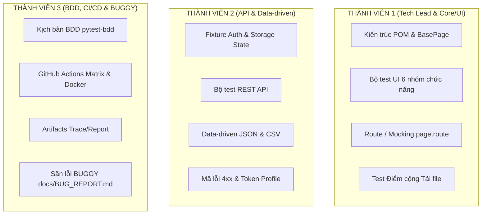

# BẢNG PHÂN CÔNG NHIỆM VỤ ĐỒ ÁN CUỐI KỲ (TASK ASSIGNMENT MATRIX)

**Học phần:** Chuyên đề Kiểm thử tự động (Automation Testing)  
**Quy mô nhóm:** 3 sinh viên  
**Hệ thống kiểm thử:** Toolshop (Môi trường PROD: `practicesoftwaretesting.com` | Môi trường BUGGY: `with-bugs.practicesoftwaretesting.com`)  
**Công nghệ chủ đạo:** Playwright + Pytest (Python) + Page Object Model + GitHub Actions CI/CD  

---

## 1. Cơ cấu Phân chia Điểm số theo Đề tài
* **Điểm sản phẩm nhóm (8.0 điểm):**
  1. Mô hình Page Object Model: `1.0 điểm`
  2. Bộ kiểm thử Giao diện UI (6 nhóm chức năng, thanh trượt, file 0 byte, tab mới): `1.5 điểm`
  3. Kiểm thử Hướng dữ liệu (Data-driven) & Fixture/Marker: `0.5 điểm`
  4. Kiểm thử REST API (APIRequestContext, mã lỗi 4xx, schema, token): `1.0 điểm`
  5. Kỹ thuật Chặn / Giả lập mạng (Route / Mocking): `0.5 điểm`
  6. Kiểm thử Hướng hành vi (BDD - Gherkin / pytest-bdd): `0.5 điểm`
  7. Quy trình Git & GitHub (Repo công khai, protected main, $\ge 3$ PRs, commit đều): `0.5 điểm`
  8. Tự động hóa CI/CD & Artifacts (Matrix 3 trình duyệt, Docker, HTML report, trace): `1.0 điểm`
  9. Kiểm thử Hồi quy trên môi trường BUGGY & Săn lỗi (Thu thập $\ge 5$ lỗi thật): `1.5 điểm`
* **Điểm vấn đáp cá nhân (2.0 điểm - Chấm riêng từng sinh viên):**
  * Giải thích chi tiết đoạn code mình đứng tên trong commit: `1.0 điểm`
  * Trả lời câu hỏi lý thuyết, kiến trúc và thuật ngữ kiểm thử: `1.0 điểm`

---

## 2. Bảng Phân công Trách nhiệm Chi tiết Từng Thành viên

---

### THÀNH VIÊN 1: TRƯỞNG NHÓM KỸ THUẬT & KIỂM THỬ UI (TECH LEAD & CORE UI ENGINEER)
* **Vai trò:** Chịu trách nhiệm kiến trúc tổng thể, lớp cơ sở POM, toàn bộ kiểm thử giao diện cốt lõi, kỹ thuật Mocking và quản trị chuẩn mực Repository.
* **Tiêu chí đồ án sở hữu chính:** Mục 3.1 (Page Object), Mục 3.2 (Test giao diện), Mục 3.6 (Route / Mocking), Điểm cộng (Tải file).

#### Danh mục công việc chi tiết từ đầu đến cuối:
1. **Khởi tạo & Cấu hình Nền tảng (ĐÃ HOÀN THÀNH ✅):**
   * Khởi tạo Git repository công khai `Final_Test_CD2`, thiết lập nhánh `main` được bảo vệ (Branch Protection).
   * Cấu hình chuẩn hóa [.gitignore](file:///c:/Cac_ki_hoc/Ki_7/Kiểm%20thử/Cuoi_Ki/.gitignore) chặn triệt để `.venv/`, `test-results/`, `report.html`, `storage_state.json` (chống trừ 0.5đ).
   * Tạo cấu trúc cây thư mục dự án chuẩn theo Mục 4 của đề tài.
   * Cấu hình fixture session autouse `playwright.selectors.set_test_id_attribute("data-test")` trong `conftest.py` (Mục 3.1).
2. **Thiết kế Khung Page Object Model (ĐÃ HOÀN THÀNH ✅):**
   * Xây dựng lớp cơ sở [BasePage.py](file:///c:/Cac_ki_hoc/Ki_7/Kiểm%20thử/Cuoi_Ki/pages/base_page.py) xử lý tự động tiền tố `ROUTE_PREFIX` cho hash routing `/#/` của BUGGY, header nav và footer.
   * Xây dựng các lớp Page Object: `home_page.py`, `product_detail_page.py`, `cart_page.py`, `checkout_page.py`, `login_page.py`, `register_page.py`, `contact_page.py`, `account_page.py`.
   * Tuân thủ 100% nguyên tắc: Locator là thuộc tính lớp, ưu tiên test-id/role, tuyệt đối không assert trong Page Object.
3. **Bộ Kiểm thử Giao diện Người dùng (ĐÃ HOÀN THÀNH ✅):**
   * Viết và xác thực 13 test cases UI (vượt mức $\ge 12$ của Mục 3.2) phủ trọn 6 nhóm chức năng trong các file:
     * `tests/ui/test_home_and_search.py`: Tìm kiếm từ khóa, **thanh trượt lọc giá (slider)**, sắp xếp tăng dần.
     * `tests/ui/test_product_detail.py`: Xem chi tiết sản phẩm, tăng/giảm số lượng.
     * `tests/ui/test_cart_and_checkout.py`: Thêm vào giỏ, cập nhật số lượng, xóa sản phẩm khỏi giỏ.
     * `tests/ui/test_auth.py`: Đăng nhập sai tài khoản ngẫu nhiên, đăng nhập đúng với tài khoản fixture.
     * `tests/ui/test_contact_and_account.py`: **Tải tệp rỗng 0 byte** lên form Contact, **click link GitHub ở footer mở tab mới**, xem profile tài khoản.
4. **Nhiệm vụ CẦN THỰC HIỆN TIẾP THEO (PENDING ⏳):**
   * **Nhiệm vụ 1: Viết bộ test Route / Mocking (Mục 3.6 - 0.5 điểm):**
     * Tạo file `tests/ui/test_mocking.py` với $\ge 2$ test cases:
       * *Test case 1:* Chặn tài nguyên (`route.abort()`) đối với hình ảnh (`**/*.{png,jpg,jpeg}`) để tăng tốc tải trang và kiểm tra độ ổn định UI.
       * *Test case 2:* Giả lập phản hồi (`route.fulfill()`) với mã lỗi `500 Internal Server Error` hoặc danh sách rỗng để kiểm chứng thông báo lỗi hiển thị trên UI.
   * **Nhiệm vụ 2: Viết test case Tải tệp xuống - ĐIỂM CỘNG (Mục 3.2):**
     * Viết test case sử dụng `with page.expect_download() as download_info` tải file PDF hóa đơn đơn hàng từ `/account/invoices`, xác thực file tải về thành công và có dung lượng hợp lệ.
   * **Nhiệm vụ 3: Mở Pull Request đầu tiên:**
     * Tạo nhánh `feat/route-mocking`, commit code và mở PR có mô tả chuẩn chỉ để Thành viên 2/3 review.
   * **Nhiệm vụ 4: Hoàn thiện tài liệu `README.md` (Mục 4):**
     * Biên soạn hướng dẫn cài đặt, chạy test, bảng phân công, badge CI và kê khai AI.
5. **Trọng tâm Ôn tập Vấn đáp Cá nhân (2.0 điểm):**
   * Giải thích tại sao chọn Page Object Model và lý do không assert trong POM.
   * Thứ tự ưu tiên của Selector (`get_by_test_id` $\to$ `get_by_role` $\to$ `get_by_label` $\to$ `CSS`), lý do hạn chế XPath.
   * Cơ chế hoạt động của `page.route()` (can thiệp tầng network của trình duyệt).
   * Kỹ thuật điều khiển chuột Playwright để kéo thanh trượt giá (`bounding_box`, `mouse.move`, `mouse.down`, `mouse.up`).

---

### THÀNH VIÊN 2: KỸ SƯ KIỂM THỬ REST API & DATA-DRIVEN (API & DATA-DRIVEN TEST SPECIALIST)
* **Vai trò:** Chịu trách nhiệm toàn bộ tầng kiểm thử dịch vụ mạng (API), cơ chế lưu trữ phiên đăng nhập (`storage_state`), và kiểm thử hướng dữ liệu (Data-driven).
* **Tiêu chí đồ án sở hữu chính:** Mục 3.3 (Data-driven), Mục 3.4 (Fixture & Marker), Mục 3.5 (Test API).

#### Danh mục công việc chi tiết từ đầu đến cuối:
1. **Thiết kế Cơ chế Fixture & Phiên Đăng nhập (ĐÃ HOÀN THÀNH ✅):**
   * Xây dựng hàm sinh mật khẩu ngẫu nhiên an toàn `generate_strong_password()` vượt qua bộ lọc từ chối mật khẩu lộ dữ liệu của Toolshop.
   * Xây dựng fixture session `registered_user` tự động tạo tài khoản độc lập qua API, xử lý tương thích kiểu địa chỉ object của PROD và chuỗi của BUGGY (Mục 1 & 2).
   * Cấu hình fixture session `storage_state_file` đăng nhập 1 lần lưu file `storage_state.json`, cung cấp fixture function `authenticated_page` để tái sử dụng phiên cực nhanh mà không phải đăng nhập lại từng test case (Mục 3.4).
2. **Bộ Kiểm thử REST API (ĐÃ HOÀN THÀNH ✅):**
   * Viết và xác thực 6 test cases API (vượt mức $\ge 5$ của Mục 3.5) sử dụng `APIRequestContext` trong [tests/api/test_api.py](file:///c:/Cac_ki_hoc/Ki_7/Kiểm%20thử/Cuoi_Ki/tests/api/test_api.py):
     * Phương thức `GET /status`: Kiểm tra trạng thái hệ sinh thái backend (200 OK).
     * Phương thức `GET /products`: Xác thực cấu trúc và kiểu dữ liệu JSON (`name: str`, `price: (int, float)`, `data: list`).
     * Phương thức `GET /products/invalid-id`: Kiểm tra mã lỗi `404 Not Found`.
     * Phương thức `POST /users/login`: Kiểm tra từ chối đăng nhập sai mã lỗi `401 Unauthorized`.
     * Phương thức `GET /users/me`: Kiểm tra xác thực bằng `Bearer Token` lấy từ login, xác minh thông tin profile.
     * Phương thức `POST /messages`: Kiểm tra gửi liên hệ (200/201 Created), đảm bảo $\ge 2$ phương thức HTTP.
3. **Nhiệm vụ CẦN THỰC HIỆN TIẾP THEO (PENDING ⏳):**
   * **Nhiệm vụ 1: Xây dựng bộ test Hướng dữ liệu - Data-driven Testing (Mục 3.3 - 0.5 điểm):**
     * Chuẩn bị file dữ liệu ngoài:
       * File `data/search_keywords.json`: Danh sách từ khóa tìm kiếm (pliers, hammer, wrench, screwdriver...).
       * File `data/contact_messages.csv`: Nhiều dòng dữ liệu test form liên hệ với các chủ đề và độ dài thông điệp khác nhau.
     * Tạo file `tests/ui/test_data_driven.py` với $\ge 2$ test cases:
       * *Test case 1:* Sử dụng `@pytest.mark.parametrize` đọc dữ liệu từ file `data/search_keywords.json` để kiểm thử tìm kiếm đa sản phẩm.
       * *Test case 2:* Sử dụng `@pytest.mark.parametrize` đọc dữ liệu từ file `data/contact_messages.csv` để kiểm thử xác thực dữ liệu đầu vào của form liên hệ.
   * **Nhiệm vụ 2: Tham gia quy trình Git & Review:**
     * Tạo nhánh `feat/data-driven-tests`, commit và mở Pull Request số 2.
     * Đóng vai trò Reviewer chính cho PR của Thành viên 1 (`feat/route-mocking`), kiểm tra checklist và bấm Approve.
   * **Nhiệm vụ 3: Cập nhật ma trận Test case:**
     * Bổ sung bảng mô tả các test case API và Data-driven vào tài liệu `README.md`.
4. **Trọng tâm Ôn tập Vấn đáp Cá nhân (2.0 điểm):**
   * Tại sao dùng `APIRequestContext` của Playwright thay vì thư viện `requests` bên ngoài?
   * Cách tổ chức fixture với 2 scope khác nhau (`session` cho đăng nhập 1 lần, `function` cho từng test).
   * Cơ chế hoạt động của `storage_state.json` (lưu cookies và localStorage của trình duyệt).
   * Ý nghĩa các mã trạng thái HTTP (200, 201, 401, 404, 422, 500) và cách xác thực cấu trúc JSON.
   * Kỹ thuật Data-driven: Cách `@pytest.mark.parametrize` đọc dữ liệu từ file JSON/CSV và ánh xạ thành nhiều lần chạy test độc lập.

---

### THÀNH VIÊN 3: KỸ SƯ BDD, DEVOPS CI/CD & REGRESSION BUGGY (BDD, CI/CD & REGRESSION LEAD)
* **Vai trò:** Chịu trách nhiệm kiểm thử hướng hành vi (BDD), thiết lập pipeline tự động hóa GitHub Actions, giải quyết rào cản mạng Cloudflare bằng Docker, và đối soát toàn diện bắt lỗi trên môi trường BUGGY.
* **Tiêu chí đồ án sở hữu chính:** Mục 3.7 (BDD), Mục 3.9 (GitHub Actions), Mục 3.10 (Báo cáo & Artifact), Mục 3.11 (Flaky test), Mục 3.12 & 3.13 (Regression BUGGY & Báo cáo lỗi).

#### Danh mục công việc chi tiết từ đầu đến cuối:
1. **Khởi tạo Mẫu Báo cáo Lỗi (ĐÃ HOÀN THÀNH ✅):**
   * Khởi tạo file mẫu báo cáo lỗi [docs/BUG_REPORT.md](file:///c:/Cac_ki_hoc/Ki_7/Kiểm%20thử/Cuoi_Ki/docs/BUG_REPORT.md) chuẩn form theo Mục 3.13.
2. **Nhiệm vụ CẦN THỰC HIỆN TIẾP THEO (PENDING ⏳):**
   * **Nhiệm vụ 1: Xây dựng Bộ Kiểm thử Hướng hành vi - BDD (Mục 3.7 - 0.5 điểm):**
     * Viết kịch bản bằng Gherkin tại `tests/bdd/features/checkout_flow.feature`:
       * 1 luồng nghiệp vụ hoàn chỉnh: `Tìm kiếm sản phẩm` $\to$ `Chọn sản phẩm` $\to$ `Thêm vào giỏ hàng` $\to$ `Tiến hành thanh toán`.
       * Bắt buộc có $\ge 1$ kịch bản mẫu `Scenario Outline` đi kèm bảng dữ liệu mẫu `Examples`.
     * Viết file định nghĩa bước (Step definitions) tại `tests/bdd/step_defs/test_checkout_flow_steps.py` bằng thư viện `pytest-bdd`.
     * **Quy tắc bắt buộc:** Các bước trong BDD phải gọi lại các phương thức của Page Object đã xây dựng (`HomePage`, `ProductDetailPage`, `CartPage`, `CheckoutPage`), không viết lại locator cục bộ.
   * **Nhiệm vụ 2: Thiết lập Pipeline GitHub Actions (Mục 3.9, 3.10, 3.11 - 1.0 điểm):**
     * Tạo file `.github/workflows/ci.yml`:
       * Kích hoạt khi: `push` vào `main`, `pull_request` vào `main`, và `workflow_dispatch`.
       * Chiến lược ma trận (Matrix Strategy): Chạy trên 3 trình duyệt `Chromium`, `Firefox`, `WebKit` trên hệ điều hành `ubuntu-latest`, đặt `fail-fast: false`.
       * **Giải quyết chặn Cloudflare:** Vì site công khai chặn máy ảo của GitHub, tích hợp bước khởi động Toolshop nội bộ bằng Docker (`toolshop/` container) trong file CI.
       * Cấu hình lưu trữ Artifacts (`actions/upload-artifact` với điều kiện `if: always()`):
         * Báo cáo HTML tự đóng gói (`pytest-html` với `--self-contained-html`).
         * Tệp vết thực thi (`--tracing=retain-on-failure`) và ảnh chụp màn hình lỗi (`--screenshot=only-on-failure`).
       * Tích hợp `pytest-rerunfailures` để tự động chạy lại các test bị lỗi do độ trễ mạng trong CI.
   * **Nhiệm vụ 3: Chạy Regression trên BUGGY & Săn lỗi (Mục 3.12, 3.13 - 1.5 điểm - Quan trọng nhất!):**
     * Thêm 1 job kiểm thử trong CI (hoặc script cấu hình máy cá nhân) trỏ sang môi trường BUGGY (`with-bugs.practicesoftwaretesting.com`, `API_URL`, `ROUTE_PREFIX=/#`), đặt cờ `continue-on-error: true`.
     * **Nguyên tắc vàng:** Không sửa bất kỳ dòng test case hay assertion nào; nếu test đỏ vì khác biệt môi trường (như đường dẫn `/#/`, API nhận chuỗi) thì xử lý bằng cấu hình biến môi trường và fixture.
     * **Chỉ tiêu săn lỗi:** Phát hiện tối thiểu **$\ge 5$ lỗi thật của hệ thống** (test xanh trên PROD nhưng đỏ trên BUGGY, chỉ ra được hành vi sai thực tế so với mong đợi).
     * Hoàn thiện tài liệu `docs/BUG_REPORT.md` kèm đầy đủ ảnh chụp màn hình lỗi hoặc trace file lưu trong `docs/screenshots/`.
   * **Nhiệm vụ 4: Tham gia quy trình Git & Review:**
     * Tạo nhánh `feat/bdd-and-ci-pipeline`, commit và mở Pull Request số 3.
     * Thực hiện review, phê duyệt cho PR số 2 của Thành viên 2.
3. **Trọng tâm Ôn tập Vấn đáp Cá nhân (2.0 điểm):**
   * Khái niệm BDD (Behavior-Driven Development), cú pháp Gherkin (Given, When, Then), tại sao lại dùng `Scenario Outline` kết hợp `Examples`.
   * Cấu trúc file workflow `.github/workflows/ci.yml` (trigger, job, step, matrix, runner).
   * Tại sao máy ảo của GitHub Actions lại bị chặn bởi Cloudflare và giải pháp Docker nội bộ hoạt động như thế nào?
   * Khái niệm Flaky test và cơ chế chống flaky bằng `pytest-rerunfailures`.
   * Phân tích chi tiết 5 lỗi phát hiện được trên môi trường BUGGY: Vì sao test phát hiện ra lỗi, tại sao lỗi đó chứng minh assertion của nhóm đủ chặt chẽ.

---

## 3. Ma trận Tổng hợp Tiến độ Dự án

| Hạng mục đề tài | Phụ trách chính | Mục tiêu tối thiểu | Trạng thái hiện tại |
| :--- | :---: | :---: | :---: |
| **1. Khung POM & BasePage** | **Thành viên 1** | Có BasePage, locator là thuộc tính, không assert | **HOÀN THÀNH (100%)** |
| **2. Test Giao diện UI** | **Thành viên 1** | $\ge 12$ TCs, đủ 6 module, slider, file 0b, tab mới | **HOÀN THÀNH (13 TCs)** |
| **3. Test Tải file xuống** | **Thành viên 1** | Điểm cộng kỹ thuật kiểm thử Playwright | **CHỜ THỰC HIỆN** |
| **4. Route / Mocking** | **Thành viên 1** | $\ge 2$ TCs: chặn ảnh, mock lỗi 500 / rỗng | **CHỜ THỰC HIỆN** |
| **5. Fixture Auth & State** | **Thành viên 2** | Session storage_state, mật khẩu ngẫu nhiên | **HOÀN THÀNH (100%)** |
| **6. Test REST API** | **Thành viên 2** | $\ge 5$ TCs, APIRequestContext, 4xx, Token | **HOÀN THÀNH (6 TCs)** |
| **7. Test Data-driven** | **Thành viên 2** | $\ge 2$ TCs `@pytest.mark.parametrize`, JSON/CSV | **CHỜ THỰC HIỆN** |
| **8. Test BDD Gherkin** | **Thành viên 3** | 1 luồng nghiệp vụ, Scenario Outline + Examples | **CHỜ THỰC HIỆN** |
| **9. GitHub Actions CI/CD** | **Thành viên 3** | Matrix 3 browser, Docker Toolshop, Artifacts | **CHỜ THỰC HIỆN** |
| **10. Regression BUGGY** | **Thành viên 3 + Nhóm** | Chạy nguyên bộ test, săn $\ge 5$ lỗi thật | **CHỜ THỰC HIỆN** |
| **11. Quy trình Git / PR** | **Cả 3 thành viên** | $\ge 3$ PRs merge, Review chéo, commit đều | **ĐANG TIẾN HÀNH** |
